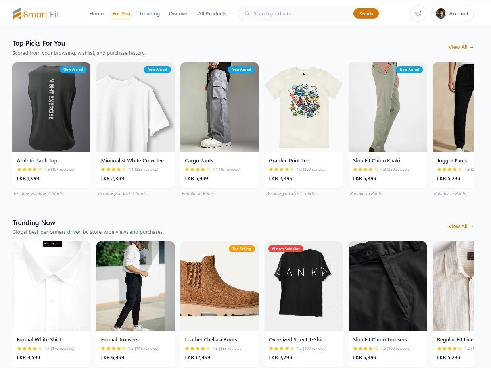
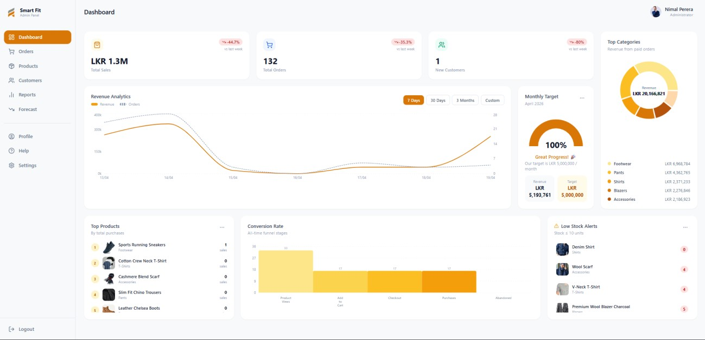
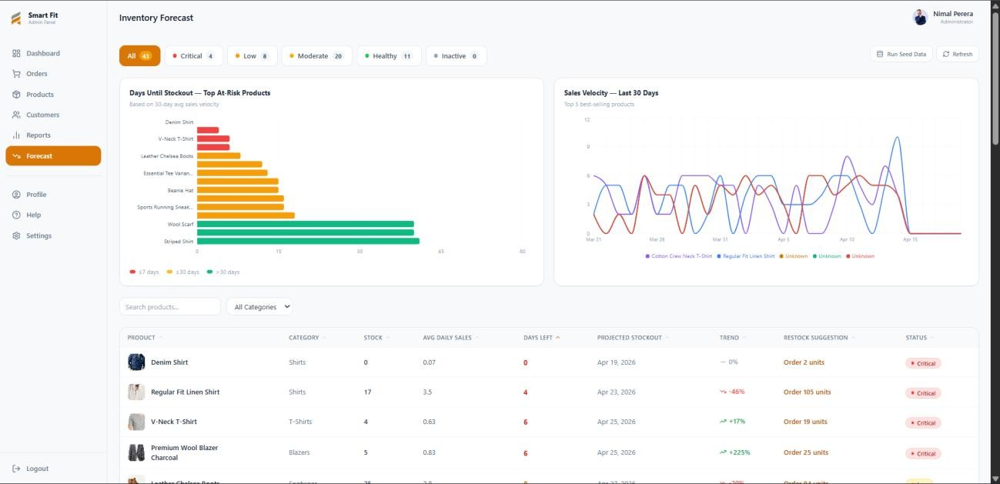

# Smart Fit

### Personalized menswear shopping, backed by retail insights.

Smart Fit is a full-stack fashion e-commerce application with a customer storefront and an admin workspace. Customers can discover clothing through a style quiz and personalized recommendations, while administrators manage products, orders, customers, reports, and inventory forecasts.

**[View Demo](https://smart-fit-alpha.vercel.app)** · **[Features](#features)** · **[Getting Started](#getting-started)** · **[Screenshots](#screenshots)**

> Shopping routes require sign-in. New customer accounts are verified through an email verification code.

## Features

### Customer Storefront

- **Product discovery** — Browse trending products, new arrivals, and an infinite-scroll discovery feed.
- **Search and suggestions** — Find products through search suggestions and detailed product pages.
- **Style quiz** — Receive product suggestions based on category, budget, fit, style, and occasion preferences.
- **Personalized recommendations** — Explore personalized picks, related products, and checkout suggestions informed by shopping activity.
- **Wishlist and cart** — Save favorite products and manage items before checkout.
- **Flexible checkout** — Pay through Stripe Checkout or submit a bank-transfer payment slip.
- **Account management** — Update profiles and avatars, manage saved addresses, change passwords, and view order history.
- **Email notifications** — Receive verification, welcome, and order/payment updates.

### Admin Workspace

- **Analytics dashboard** — View revenue charts, weekly statistics, category performance, conversion metrics, top products, and low-stock alerts.
- **Product management** — Create and edit products, manage categories and inventory, and upload product images.
- **Order management** — Review orders and manual payments, and update order statuses.
- **Customer management** — View and manage customer accounts.
- **Business reports** — Explore sales summaries, revenue breakdowns, product and category performance, customer insights, and inventory snapshots.
- **Inventory forecasting** — Review estimated stockout dates, stock-risk levels, suggested restock quantities, and sales projections.
- **Store settings** — Manage administration settings and recommendation maintenance actions.

## Recommendation and Forecasting Logic

Smart Fit implements its recommendation and forecasting features in server-side JavaScript.

| Feature | Approach |
| --- | --- |
| Personalized picks | Weighted shopping interactions, category preferences, price proximity, trending scores, and product recency |
| Customers Also Viewed | Co-view activity, with wishlist/purchase boosts and category-based fallbacks |
| Style quiz | Product filtering and weighted matching against quiz preferences |
| Discovery feed | A combination of personalized products, unfamiliar categories, trending items, and new arrivals |
| Checkout suggestions | Wishlist activity, repeated views, complementary categories, and trending products |
| Inventory forecasting | Average daily sales, estimated stockout dates, week-over-week trends, and heuristic sales projections |

Trending products provide a fallback when a customer has insufficient activity for personalization.

Inventory estimates use a 30-day sales window, with a 90-day fallback where applicable. The sales-trend view also includes a 14-day projection.

These features use scoring rules, collaborative filtering, and statistical heuristics. The repository does not include a separately trained machine-learning model or an external LLM integration. Results depend on the available product, interaction, and sales data.

## Tech Stack

| Layer | Technologies |
| --- | --- |
| Frontend | React 19, Vite 8, React Router 7 |
| Styling | Tailwind CSS 3, Lucide React |
| Charts and reporting | Recharts, jsPDF |
| Backend | Node.js, Express 5 |
| Database | MongoDB, Mongoose 9 |
| Authentication | JSON Web Tokens, bcryptjs, role-based access |
| File uploads | Cloudinary, Multer |
| Payments | Stripe Checkout, manual bank transfers |
| Email | Nodemailer with Gmail |
| Scheduled tasks | node-cron |

## Project Structure

| Directory | Purpose |
| --- | --- |
| `client/src/pages/customer/` | Storefront, search, product details, checkout, and customer profile |
| `client/src/pages/admin/` | Dashboard, products, orders, customers, reports, and forecasting |
| `client/src/components/` | Shared layouts, product components, recommendations, and style quiz |
| `client/src/context/` | Authentication and wishlist state |
| `client/src/lib/` | API requests, storage, formatting, and activity tracking |
| `client/src/routes/` | Authentication and role guards |
| `server/routes/` | API route definitions |
| `server/controllers/` | Request handling |
| `server/services/` | Business logic, recommendations, analytics, payments, and email |
| `server/models/` | MongoDB schemas |
| `server/middleware/` | Authentication and upload middleware |
| `server/scripts/` | Admin creation, diagnostics, and synthetic data helpers |
| `server/.env.example` | Backend environment template |

## Getting Started

### Prerequisites

- Git
- Node.js **22.12 or later** and npm
- A local MongoDB instance or MongoDB Atlas database
- Gmail credentials with an app password for verification and transactional emails
- Cloudinary credentials for image and payment-slip uploads
- Stripe test credentials to test card payments

### 1. Clone the Repository

```bash
git clone https://github.com/Salman-Faizal/smart-fit.git
cd smart-fit
```

### 2. Install Dependencies

```bash
npm ci --prefix server
npm ci --prefix client
```

The frontend and backend have separate dependency manifests. There is no root-level installation or start script.

### 3. Configure the Backend

Copy `server/.env.example` to `server/.env` and replace the placeholder values.

For local development, use:

```dotenv
# Database
MONGO_URI=mongodb://127.0.0.1:27017/smart-fit

# Authentication
JWT_SECRET=replace-with-a-long-random-secret

# Server and frontend URLs
PORT=3000
CLIENT_URL=http://localhost:5173
FRONTEND_URL=http://localhost:5173
CORS_ORIGIN=http://localhost:5173

# Email
GMAIL_USER=your-email@gmail.com
GMAIL_APP_PASSWORD=your-gmail-app-password

# Cloudinary
CLOUDINARY_CLOUD_NAME=your-cloud-name
CLOUDINARY_API_KEY=your-api-key
CLOUDINARY_API_SECRET=your-api-secret

# Stripe
STRIPE_SECRET_KEY=sk_test_replace_me
STRIPE_WEBHOOK_SECRET=whsec_replace_me
STRIPE_CURRENCY=usd
```

> `FRONTEND_URL`, `GMAIL_USER`, and `GMAIL_APP_PASSWORD` are used by the email service but are not included in the current `.env.example`. Add them manually.

Generate a JWT secret with:

```bash
node -e "console.log(require('crypto').randomBytes(64).toString('hex'))"
```

Keep real credentials out of version control.

Email configuration is required to receive registration codes. Cloudinary credentials are required for uploads, and Stripe credentials are required for the Stripe payment flow.

#### Payment Currency

The UI formats prices in LKR, while Stripe defaults to `usd`. The backend sends stored numeric prices to Stripe without performing currency conversion.

Confirm that the configured Stripe currency matches the currency of the stored prices before testing payments. Use Stripe test mode during development.

### 4. Configure the Frontend

Create `client/.env.local`:

```dotenv
VITE_API_BASE_URL=http://localhost:3000
```

Use the backend origin; the client appends `/api`.

This setting is important because the API helper otherwise defaults to the hosted Render backend. Restart Vite after changing environment values.

### 5. Start the Application

Start the backend:

```bash
cd server
node server.js
```

In another terminal, start the frontend:

```bash
cd client
npm run dev
```

| Service | Local URL |
| --- | --- |
| Frontend | http://localhost:5173 |
| Backend | http://localhost:3000 |

The backend root endpoint returns `API Running...`.

### 6. Create Accounts and Add Products

1. Register a customer account and complete email verification.
2. To access the admin workspace locally, change that account's `role` to `admin` in MongoDB.
3. Sign in again to obtain a token containing the updated role.
4. Use the admin product screens to populate the catalog.

The repository includes `server/scripts/createAdmin.js`, but it contains fixed example credentials and does not load dotenv itself. Review and adapt it before use.

A complete product-catalog seed is not included. Recommendation sections require eligible products, personalization requires shopping activity, and sales-based forecasts require paid-order data.

Synthetic interaction and sales-data helpers are available in `server/scripts/`. Review them before running them against a disposable development database.

### Optional: Test Stripe Webhooks Locally

With the Stripe CLI installed and authenticated, run:

```bash
stripe listen --forward-to localhost:3000/api/payments/stripe-webhook
```

Copy the signing secret into `STRIPE_WEBHOOK_SECRET`, restart the backend, and keep the listener running during payment testing.

## Available Commands

### Frontend

Run these commands from `client/`:

| Command | Purpose |
| --- | --- |
| `npm run dev` | Start the development server |
| `npm run build` | Generate a production build in `client/dist/` |
| `npm run preview` | Preview the production build locally |
| `npm run lint` | Run ESLint |

### Backend

Run from `server/`:

```bash
node server.js
```

The backend's current `npm test` command is a placeholder that exits with an error. No automated test suite is configured in the package scripts.

## Deployment Configuration

Set `VITE_API_BASE_URL` to the deployed backend origin **before building the frontend**.

Configure the backend with:

- Database and authentication credentials
- Cloudinary and email credentials
- Stripe configuration, if enabled
- `CLIENT_URL` for checkout redirects
- `FRONTEND_URL` for email links
- `CORS_ORIGIN` for allowed frontend origins

A Vercel SPA rewrite configuration is included in `client/vercel.json`.

## Screenshots

### Customer Storefront


### Style Quiz


### Admin Dashboard


### Inventory Forecasting


## Development Acknowledgment

This project was developed with assistance from **Claude Code**, particularly for the recommendation and forecasting logic, while I was building experience with these algorithms.

## Author

**[Salman Faizal](https://github.com/Salman-Faizal)**
